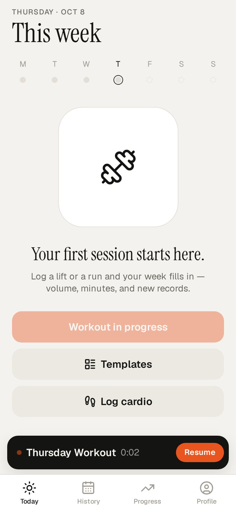
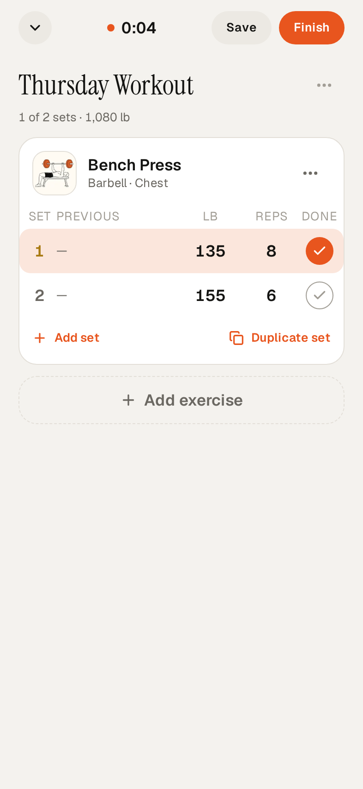
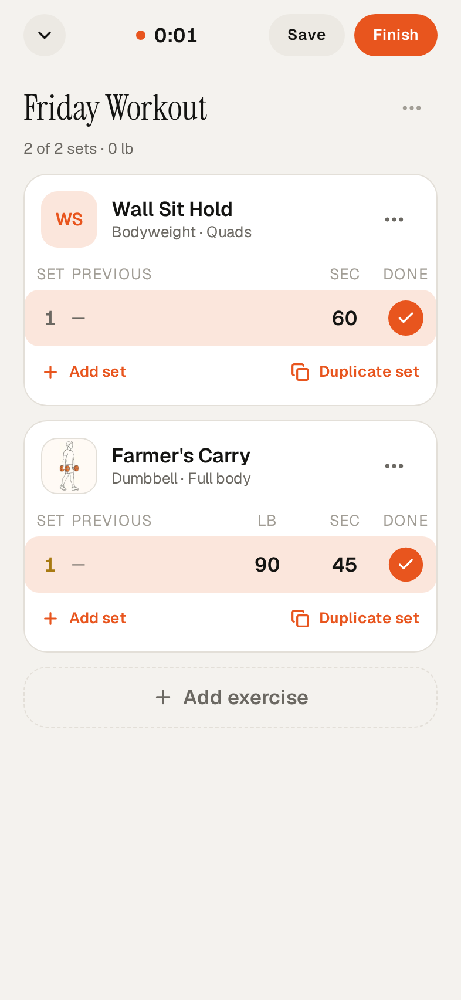
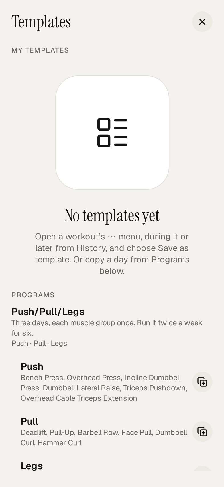

# Setwise

Personal strength-tracking / set-by-set lifting app for Sixtus’s own use. Mostly AI-generated. Built with **Cursor** to test the capabilities of the **Cursor Projects** feature.

Setwise logs exercises set by set (weight × reps, timed holds, weighted-time carries), cardio sessions, templates and built-in programs, progress charts, and PRs. With no Supabase URL configured it runs in **local mode** and keeps data on the device.

## Why I made this

I wanted a way to log my fitness journey and track my strength and lifts over time, in a free app with no ads.

## Features

- Active workout with Done checkmarks, steppers, duplicate set, mid-workout Save
- Exercise library with search aliases, custom exercises, and track types (reps, timed, weighted-time)
- Templates + built-in programs (e.g. Push/Pull/Legs)
- History, progress charts, estimated 1RM / PRs
- Cardio logging
- First-run tutorial
- Optional Supabase sync (free tier) with RLS; otherwise local-only

## Stack

- **Expo SDK 57** + **expo-router** (React Native / TypeScript)
- **Supabase** (Postgres + Auth) when `EXPO_PUBLIC_SUPABASE_*` are set
- Zustand drafts, TanStack Query, Jest + Playwright

## Demo

<p>
  
  
  
  
</p>

More stills in [`docs/demo/`](docs/demo/): Save pill, template start, tutorial, Farmer’s Carry progress, active workout sheet.

Demo media was captured in local mode with synthetic lifts (no real names, emails, or account data). Podcast/delivery notes from the capture session are intentionally omitted.

## Setup

```bash
npm install
cp .env.example .env   # leave values empty for local mode
npm start              # Expo Go, SDK 57
npm run web            # http://127.0.0.1:19417
```

For hosted sync, set in `.env` (never commit real values):

```
EXPO_PUBLIC_SUPABASE_URL=
EXPO_PUBLIC_SUPABASE_ANON_KEY=
```

Only the project URL and publishable/anon key belong in the client. The service-role key is never used by the app.

## Checks

```bash
npx tsc --noEmit
npm test
npm run lint
npm run e2e            # Playwright
npm run test:db        # pgTAP (local Postgres)
```

## Layout

- `app/`: Expo Router screens
- `src/`: UI, workout draft, data repos, theme
- `supabase/`: migrations + RLS tests
- `docs/`: architecture, security, design, demo media
- `DECISIONS.md`: stack and product decisions

## Privacy

Private personal project. Not published as a product.
