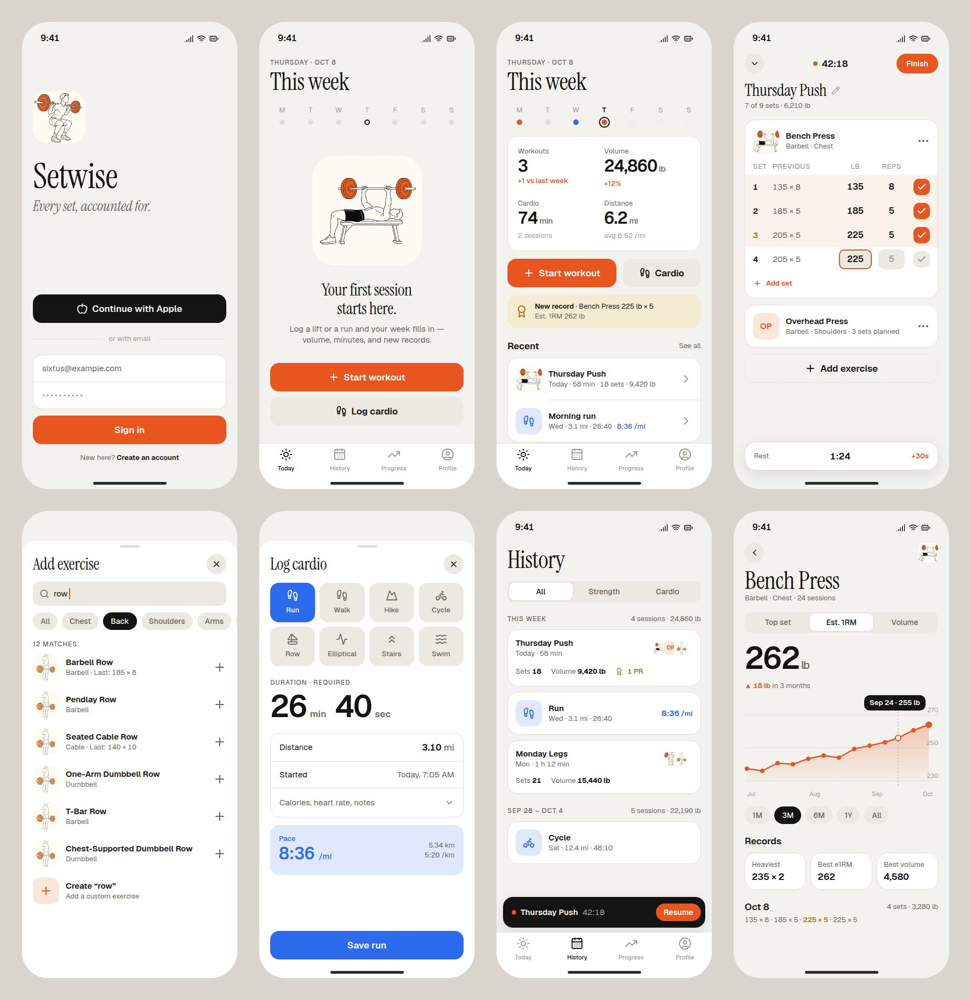
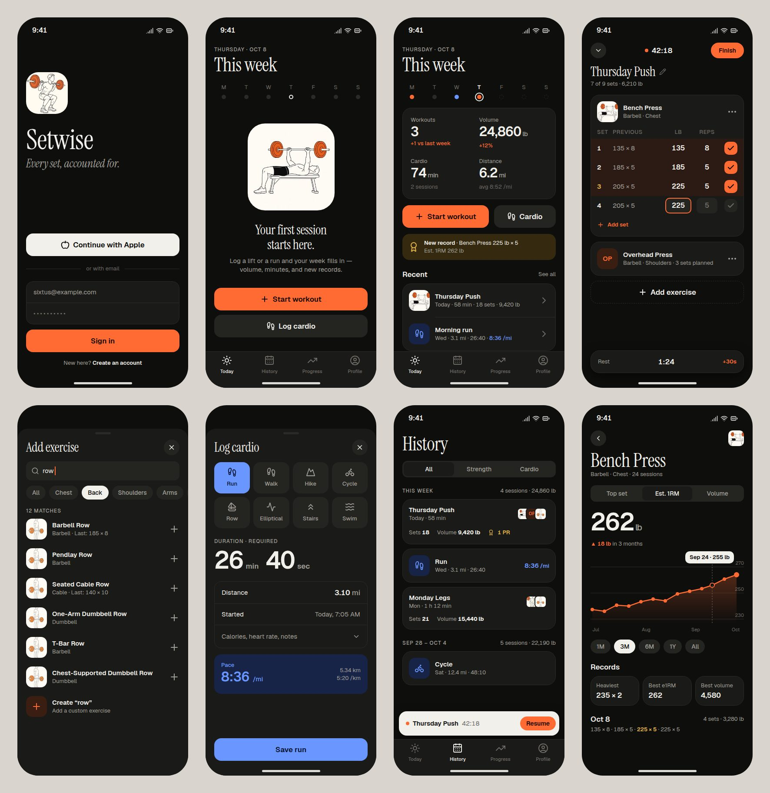

# Design

**Direction: a training journal, not a gym poster.** Warm paper and ink, editorial serif headlines, crisp tabular numbers, and one confident ember accent. Color carries meaning: ember is strength and action, tide blue is cardio, brass is records. Everything else stays neutral, so data is what you notice.

| Light | Dark |
| --- | --- |
|  |  |

Per-screen renders are in `mockups/screens/` (`<screen>-<light|dark>.jpg`). The source is `mockups/mockups.html`, and `node docs/mockups/render.mjs` re-renders it. The mockups are the reference for layout and feel. This doc is the spec.

## Tokens (`src/theme/tokens.ts`)

### Color

| Token | Light | Dark | Use |
| --- | --- | --- | --- |
| `bg` | `#F4F2EE` | `#0E0E0D` | Screen background |
| `surface` | `#FFFFFF` | `#1A1A18` | Cards, sheets, tab bar |
| `sunken` | `#ECE9E3` | `#242421` | Inputs, secondary buttons, segmented track, pills |
| `hairline` | `#E3DFD8` | `#2B2A27` | 1 px borders and dividers (instead of shadows) |
| `ink` | `#141412` | `#F2F0EB` | Primary text, selected pill |
| `ink2` | `#6B6862` | `#A3A099` | Secondary text |
| `ink3` | `#A19D95` | `#6E6B65` | Tertiary text, placeholders, inactive tabs |
| `accent` / `accentInk` | `#E8551E` / `#FFFFFF` | `#FF6B33` / `#160A04` | Primary CTA, completed sets, chart line, positive deltas |
| `accentSoft` | `#FBE6DC` | `#3A1E12` | Completed-set row tint, monogram tiles |
| `cardio` / `cardioInk` | `#2C6BED` / `#FFFFFF` | `#6A97FF` / `#06122E` | Cardio CTA, pace, cardio icons |
| `cardioSoft` | `#DFE8FC` | `#172447` | Cardio icon tiles, pace callout |
| `pr` / `prSoft` | `#A87A12` / `#F5EBD3` | `#E2B44A` / `#352A10` | Records: badge, banner, PR set number |
| `danger` | `#C8361F` | `#FF6A5C` | Destructive actions, error text |
| `tile` | `#F4F2EE` | `#EDEAE4` | Illustration tile (stays "paper" in dark mode, like a print) |

Contrast: body text on `bg` and `surface` is ≥ 7:1 in both themes. `ink2` is ≥ 4.5:1. Accent buttons use `accentInk`, and the dark theme uses dark ink on the bright accent so it clears 4.5:1.

### Type

Fonts are Instrument Serif 400 (headlines) and Geist 400/500/600/700 (everything else), via `@expo-google-fonts/*`. Both are bundled and work in Expo Go. All numbers use `fontVariant: ['tabular-nums']`.

| Style | Font | Size / line | Use |
| --- | --- | --- | --- |
| `display` | Instrument Serif | 44 / 46 (38 / 40 under 380 pt wide) | Tab screen titles, exercise name on detail |
| `title` | Instrument Serif | 30 / 34 | Sheet titles, workout title, empty-state headline |
| `statXL` | Geist 600, −3% tracking | 56 / 58 | Hero metric (e1RM, cardio duration) |
| `stat` | Geist 600, −2% tracking | 30 / 36 | Summary tiles, pace |
| `headline` | Geist 600 | 17 / 22 | Section heads, row titles |
| `body` | Geist 400 | 15 / 20 | Default |
| `footnote` | Geist 400 | 13 / 18 | Meta lines ("Today · 58 min · 18 sets") |
| `overline` | Geist 500, uppercase, +8% tracking | 12 / 16 | Date line, section labels ("THIS WEEK") |

Dynamic Type: `allowFontScaling` stays on, with `maxFontSizeMultiplier` 1.3 on dense numeric rows (set table, stat tiles) and 1.6 elsewhere.

### Space, radius, elevation, motion

- **Spacing:** a 4-pt scale: `4 8 12 16 20 24 32 40 56`. The screen gutter is 20, or 16 under 380 pt wide. Cards have 14–18 internal padding.
- **Radius:** inputs and rows 10–12, buttons and tiles 16, cards 20, sheets 24, pills 999, thumbnails 14 (48 px) / 8 (28 px).
- **Elevation:** use hairlines, not shadows. The one exception is floating elements (ActiveWorkoutBar, rest timer), which get `0 8 24 rgba(0,0,0,.10)` in light and `.5` in dark.
- **Motion:** 200 ms ease-out for state changes. Sheets use native presentation. Completing a set scales the check 0.9 → 1 with a light haptic (`expo-haptics`). Chart scrubbing gives a selection haptic per point. Respect Reduce Motion.

## Iconography and imagery

- **Icons:** `lucide-react-native` at 1.9 px stroke (2.25 in buttons). Sizes are 24 for tabs, 20 in buttons, 18 inline. Cardio icons: run/walk `footprints`, hike `mountain`, cycle `bike`, row `sailboat`, elliptical `activity`, stairs `chevrons-up`, swim `waves`, other `heart-pulse`.
- **Exercise illustrations** (`assets/exercises/*.webp`, 384 px, about 15 KB each): ink monoline line art with ember plates, on a paper tile. They come from one locked prompt, with only the movement changing:

  > Minimal editorial fitness illustration for a mobile app exercise thumbnail. A single athlete performing **{movement}**, side view, drawn as clean confident monoline vector strokes in near-black ink (#141412) with one flat accent fill in warm ember orange (#E8551E) on the {equipment accent} only. Background: solid warm off-white paper color (#F4F2EE), no texture, no gradient. Figure centered occupying ~80% of the frame. Faceless, stylized but anatomically correct, no text, no logos, no shadows, no border.

  Coverage: a dedicated illustration only when the drawing is that exact movement, plus one shared rest-pose placeholder (ember shoes, arms hanging, no equipment and no bench) for every other library lift. A library lift never shows a different exercise. Custom exercises get a **monogram tile** (`accentSoft` with initials in `accent`). Thumbnails crop at about 155% zoom so the figure reads at 48 px. Samples are in `mockups/img/`.

## Components (`src/ui`)

| Component | Spec |
| --- | --- |
| `Button` | Height 52, radius 16, `headline` label, optional leading icon. Variants: `primary` (accent), `cardio`, `secondary` (sunken), `ghost`, `danger`. Loading swaps the label for a spinner and keeps the width. Disabled is 40% opacity. |
| `IconButton` | 36 circle, `sunken`, 18 icon. Hit slop of 8. |
| `Card` | `surface`, radius 20, hairline border |
| `Pill` | 32 high. Off: `sunken`/`ink2`. On: `ink`/`bg`. Used for filters and ranges. Scrolls horizontally. |
| `Segmented` | `sunken` track, 3 pt inset, the selected segment is `surface` with a micro shadow |
| `Field` / `NumberField` | Grouped rows inside a Card (label left, value right) or a standalone `sunken` input with radius 12. `NumberField` uses `decimal-pad` / `number-pad`, selects all on focus, and draws a 2 px accent focus ring. |
| `ListRow` | 48 thumb or icon tile, title (`headline`), meta (`footnote` `ink2`), trailing chevron or action. Dividers inset 74. |
| `Thumb` | Illustration, monogram, or cardio icon tile. 48 / 36 / 28 sizes. Stacks overlap by −8 with a `surface` ring. |
| `StatTile` | Label `footnote` `ink2`, value `stat` with a smaller `ink2` unit, delta `footnote` (accent if positive, `ink3` if neutral) |
| `SetRow` | Columns: set # (36) · previous (flex, `ink2`) · weight (72) · reps (60) · check (40). A completed row gets a 55% `accentSoft` tint and a filled accent check. A PR set's number is drawn in `pr`. |
| `LineChart` | SVG with a monotone curve and 2.5 px accent stroke. Area gradient from 28% to 0. Three hairline gridlines with right-aligned `ink3` labels. Month ticks. 3 px dots, with the last one 5 px. Press and drag to scrub, showing a dashed guide and an `ink` tooltip ("Sep 24 · 255 lb"). Height 190. |
| `EmptyState` | Illustration (200 tile) or icon, `title` serif headline, one `body` `ink2` line, primary CTA |
| `Skeleton` | `sunken` blocks matching the final layout, with a 1.2 s opacity pulse. No spinners for content. |
| `Banner` | Inline, radius 16, soft tone background (`prSoft`, `cardioSoft`, `sunken`) with an icon and text. Used for PR, offline, and error states. |
| `ActiveWorkoutBar` | Floats 8 above the tab bar, 56 high, radius 18, `ink` background (inverted), pulsing accent dot, title, elapsed time, accent "Resume" pill |

## Screens

All tab screens use a large serif title in scroll content (not a nav bar), with the safe-area top inset plus 12. **Loading** means skeletons in the final layout. **Error** means an inline `Banner` with "Couldn't load — Retry" while cached data stays visible. A full-screen error only appears when there's no cache.

1. **Sign in** (`(auth)/sign-in`): app tile illustration, `Setwise` at 64 serif, italic tagline "Every set, accounted for." The bottom stack holds Continue with Apple (iOS, once slice 9 lands), an "or with email" divider, a grouped email/password field, a primary "Sign in" button, and a "Create an account" toggle. *States:* submitting (button loading), inline `danger` error under the fields ("Wrong email or password"), and local mode, which replaces the stack with "Continue in local mode" plus a note that data stays on this device.
2. **Today** (tab): date overline and a "This week" display title. A Mon–Sun week strip uses 10 px dots: ember for strength, tide for cardio, both as a split dot, hairline for rest, dashed for future days, and today gets an outline ring. Below it, a summary card with 2×2 `StatTile`s (Workouts, Volume, Cardio min, Distance with avg pace), each with a delta vs last week. A CTA row holds "Start workout" (primary, 1.4 flex) and "Cardio" (secondary). A PR banner shows when a record was set this week. "Recent" lists the last 3 sessions. *Empty:* the strip stays, and the hero becomes `EmptyState` "Your first session starts here." with both CTAs. *Offline with pending writes:* a `sunken` banner reads "3 changes will sync when you're back online."
3. **Active workout** (`workout/active`, full-screen modal): top bar with a minimize chevron, a live elapsed timer with an accent dot, and an accent "Finish" pill. An editable serif title (default: weekday plus "Workout") with a progress meta line ("7 of 9 sets · 6,210 lb"). One `Card` per exercise holds a thumb, name, equipment · muscle, an overflow menu (reorder, notes, remove), the set table, and "+ Add set". "+ Add exercise" is a dashed full-width button that opens the picker. *Previous* is prefilled from the last session of that exercise, and tapping it copies the values in. The check marks a set done (haptic) and starts an optional rest timer pill (1:30 default, +30 s). *Empty:* the dashed button grows into a 120 pt tall target labeled "Add your first exercise". *Finish* confirms when some sets aren't checked: "Finish and drop 2 empty sets?" *Discard* lives in the overflow menu and asks for confirmation.
4. **Exercise picker** (`exercise/picker`, sheet): serif title and a close button. The search field autofocuses, with the placeholder "Search 153 exercises". Muscle-group pills: All, Chest, Back, Shoulders, Arms (biceps, triceps, forearms), Legs (quads, hamstrings, glutes, calves), Core, Full body. With no query, it shows **Recent** (last 8 used) and then A–Z sections. Rows show a thumb, name, equipment, and "Last: 185 × 8" when known. Tapping a row adds it and closes. The last row is always "Create “{query}”", which opens `exercise/new` prefilled. *Empty results:* only the create row, plus "No match in the library."
5. **New exercise** (`exercise/new`, sheet): name field, muscle-group pills, equipment pills, Save (disabled until valid). *Error:* a duplicate name shows "You already have an exercise called …".
6. **Log cardio** (`cardio/new`, sheet, tide-themed): a 4×2 activity grid of icon tiles (selected = `cardio` fill). Duration is required, entered as big `statXL` minute and second fields (hours appear past 59 min). A grouped card holds Distance (mi/km), Started (defaults to now, editable), and a collapsed "Calories, heart rate, notes". A pace callout (`cardioSoft`) appears for run/walk/hike once there's a distance: "8:36 /mi", with km equivalents on the right. The full-width button reads "Save {activity}". *Validation:* Save stays disabled until there's an activity and a duration of at least 1 s.
7. **History** (tab): "History" title, an All / Strength / Cardio segmented control, and week sections ("THIS WEEK · 4 sessions · 24,860 lb"). Strength cards show title, day · duration, a stack of up to 3 thumbs, and Sets / Volume / PR count. Cardio cards show an icon tile, activity, day · distance · duration, and pace on the right in tide. Infinite scroll loads 20 at a time, and pull-to-refresh is available. *Empty:* "Nothing logged yet" with a Start workout CTA. *Filtered empty:* "No cardio yet" and similar.
8. **Workout detail** (`workout/[id]`): serif title, date and time, and a stat row (Duration, Sets, Volume). Each exercise lists its sets ("225 × 5"), with PR sets in brass and an award icon. The header menu offers Edit (opens it in the active editor) and Delete (confirm, then optimistic removal). **Cardio detail** mirrors this with the hero duration, distance, pace, and extras.
9. **Progress** (tab): "Progress" title, a search field, and the exercises you've logged sorted by most recent. Each row shows a thumb, name, a 64×24 sparkline of e1RM, and the current e1RM on the right. *Empty:* "Log a workout to see your progress" with a squat illustration.
10. **Exercise progress** (`exercise/[id]`): back button, small thumb, serif name, and meta ("Barbell · Chest · 24 sessions"). A Top set / Est. 1RM / Volume segmented control drives the `statXL` current value and the delta for the selected range. Below that, `LineChart`, then 1M / 3M / 6M / 1Y / All pills, Records tiles (Heaviest, Best e1RM, Best volume), and session history, newest first. *A single data point* shows the dot and the value, with the caption "One more session to see a trend." *Bodyweight lifts* swap the metrics for Max reps / Total reps.
11. **Profile** (tab): "Profile" title. Grouped cards cover Units (Segmented lb·mi / kg·km, saved to `profiles`, applied everywhere immediately), Appearance (System / Light / Dark), Exercises (custom list with delete; used ones explain why they can't be deleted), Sync ("All changes saved" or "3 waiting"), and Account (email, Sign out, and, in slice 10, Delete account with a typed confirmation). The footer shows the version. *Local mode:* the Account card shows a "Local mode" label with an explanation.

## Responsive rules (iPhone only, portrait)

| Width class | Devices | Rules |
| --- | --- | --- |
| Compact (< 380) | SE 2/3 (375×667), 12/13 mini | 16 gutter. `display` drops to 38. Stat values use `adjustsFontSizeToFit` (min scale 0.8). The set table's *previous* column shrinks to fit content. The Today CTA row must stay above the fold on 667 high (it sits right below the summary card). |
| Regular (380–419) | 15/16/17 (393, 402) | Baseline: these mockups |
| Large (≥ 420) | Plus/Pro Max (430, 440) | 20 gutter. Content isn't stretched beyond comfortable measure: chart height becomes 220, and lists show more rows rather than bigger ones. |

- Safe areas come from `react-native-safe-area-context` and cover the Dynamic Island and home indicator. Sheets respect the bottom inset.
- Keyboard: the set table and cardio fields scroll into view (`automaticallyAdjustKeyboardInsets`). Number pads get a "Done" accessory, and Next moves weight → reps → next set.
- Hit targets are at least 44 pt (checks are 30 visible inside a 44 hit area).
- Orientation is locked to portrait. iPad isn't supported (`supportsTablet: false`).
- Accessibility: every icon-only control has an `accessibilityLabel`. Set rows read as "Set 3, 225 pounds, 5 reps, completed". Charts expose a summary label ("Estimated one-rep max up 18 pounds in 3 months").
